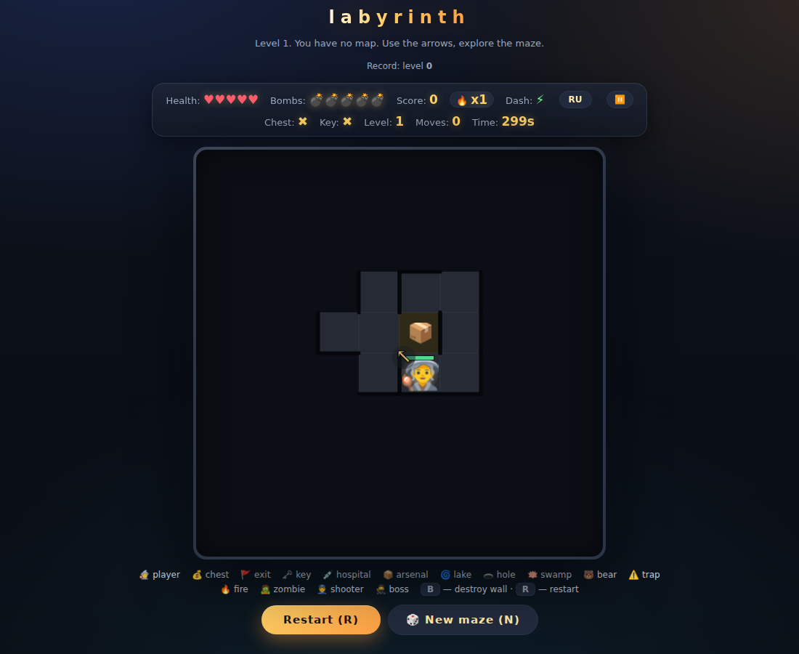
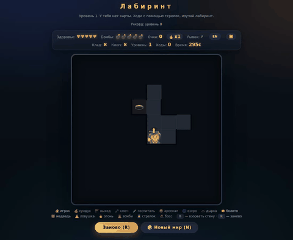

# ЛАБИРИНТ

🕹️ тактика · ⏱️ 5 минут на уровень · 🦀 Rust → WASM

[▶ Играть онлайн](https://alexandermyasnikov.github.io/labyrinth/)

Тактическая игра-лабиринт с туманом войны, преследующими врагами и растущей сложностью — переписана с JS на Rust (wasm-bindgen + web-sys + gloo), собирается Trunk в статичный WASM. Найди и вынеси сундук через выход, пока тебя не поймали.





## Звук
Синтезируется на лету через Web Audio — без аудиофайлов: шаги, выстрелы, взрывы, рычание медведей.

## Как играть

```
cargo install trunk
rustup target add wasm32-unknown-unknown
trunk serve   # http://localhost:8080
```


**Цель:** вынеси сундук 💰 через выход 🚩. Для победы нужны и сундук, и ключ 🗝️ — выход закрыт, пока у тебя нет ключа. Всё — до истечения 5 минут, иначе поражение.

### Управление
| Действие | Клавиши |
|---|---|
| Ход | `←↑↓→` или `WASD` (кулдаун ~0,15 с) |
| Рывок через клетку | `Shift` + стрелка (кулдаун ~1,5 с, нужен проход между клетками) |
| Взорвать стену | `B` (выбор направления, затем клавиша) |
| Заново | `R` |
| Новый мир (случайный сид) | `N` или кнопка 🎲 |
| Помощь | `H` |
| Пауза | `P` / `Esc` (останавливает таймер и врагов) |
| Ход на телефоне | сенсорные кнопки ▲◀▼▶, ⚡ рывок, 💣 бомба (появляются всегда под картой) |

Под картой всплывают подсказки о событиях («Стена!», «Дверь закрыта. Нужен ключ», результат взрыва).

### Спец-клетки
| Клетка | Эффект |
|---|---|
| 💰 сундук | Цель — вынести через выход |
| 🗝️ ключ | Открывает выход |
| 🚩 выход | При сундуке и ключе — победа |
| 💉 госпиталь | Восстанавливает здоровье (5) |
| 📦 арсенал | Здоровье и бомбы до 5 |
| 🌀 озеро | Несёт течением: сразу и каждые 2 с |
| 🪷 болото | Пропуск 3 ходов при входе |
| 🕳 дырка | Проваливает в следующую дырку |
| ⚠️ ловушка | Ранение (вероятность 50%) |
| 🔥 огонь | Урон при входе |
| 🧟 зомби | Преследует (в радиусе ~5) и кусает |
| 👮 стрелок | Целится и стреляет |
| 🥷 охотник-босс | Преследует, на близкой дистанции стреляет |
| 🐻 медведь | Преследует, ходит сам каждые ~1,8 с |

## Механики

- **Туман войны** — видимость радиусом 3 по проходам (не сквозь стены). Пройденные клетки остаются затемнённой памятью, непройденные скрыты. Босс виден сквозь туман. **Камера следует за игроком** — виден участок ~10×10 лабиринта 20×20.
- **Охотник-босс (BFS)** — всегда знает твою позицию и идёт кратчайшим путём. На дистанции до 3 по прямой целится и стреляет, вплотную бьёт на −2.
- **Сундук хрупок** — когда здоровье игрока опускается ниже 3 (до 1–2), любое ранение (медведь, зомби, ловушка, стрелок, огонь, босс) роняет сундук, и он возвращается на свою исходную клетку (придётся возвращаться). Пока здоровье 3 и выше — сундук не выпадает.
- **Каменные стены** — примерно 3 из 5 не взрываются бомбой, и заряд при этом всё равно сгорает; где такие стены — не помечено, узнаёшь на опыте.
- **Прогрессия** — победа поднимает сложность: добавляются медведи и ловушки, со 2-го уровня ещё и огонь; поражение откидывает на уровень 1.
- **Пульс-стрелка на поле** показывает направление к активной цели (ключ → сундук → выход), в т.ч. по диагонали.
- **Очки и комбо** — быстрые ходы подряд дают бонус-очки (серия сгорает при стене); победа даёт 1000 очков, итог виден на экране победы.
- **Достижения** — «Первый выход», «Серия из 10 быстрых ходов», «Разведал ≥150 клеток», «Победа за 90 секунд», «Победа без урона»; сохраняются в localStorage (`labyrinth.stats`).
- **Сид лабиринта** — `?seed=123` (повторяемый) или дата `?seed=20261106` (один лабиринт на день); без сида — случайный каждый запуск.
- **Частицы и тряска камеры** — при взрывах, попаданиях и победе.
- **Пауза** (`P`/`Esc`) — останавливает таймер и всех врагов, кнопкой ⏸ в HUD, кнопкой или кликом по фону оверлея.
- **Подвал страницы** — ссылки на GitHub, сид дня (сегодняшняя дата `?seed=YYYYMMDD`) и сид 123; клик по фону помощи закрывает её.

## Текущие цифры баланса
- Сетка 20×20, 400 клеток.
- 5 сердец здоровья, 5 бомб, 300 секунд на уровень.
- На старте ставится 7 стрелков, 10 зомби, 1 охотник-босс (после отсева от стартовой зоны — чуть меньше).
- Медведи до 30, ловушки до 5, огонь растёт с уровнем.

## Структура проекта
```
index.html             — каркас: HTML + CSS, JS выброшен (только Trunk-загрузчик)
src/game.rs            — ядро игры без веба (генерация, BFS, враги, i18n) — 1-в-1 из старого JS
src/web.rs             — обвязка wasm32: канвас, HUD, ввод, звук, таймеры, localStorage
src/tests.rs           — 105 тестов ядра (cargo test)
specs/features.feature — Gherkin-спецификация (BDD, ~95 сценариев)
```
## Тесты
```
cargo test   # 105/105
trunk build  # dist/ — статика для GitHub Pages
```